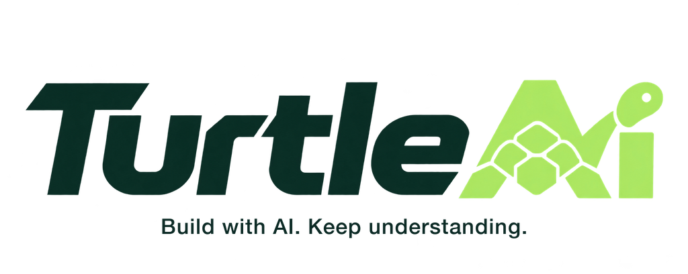
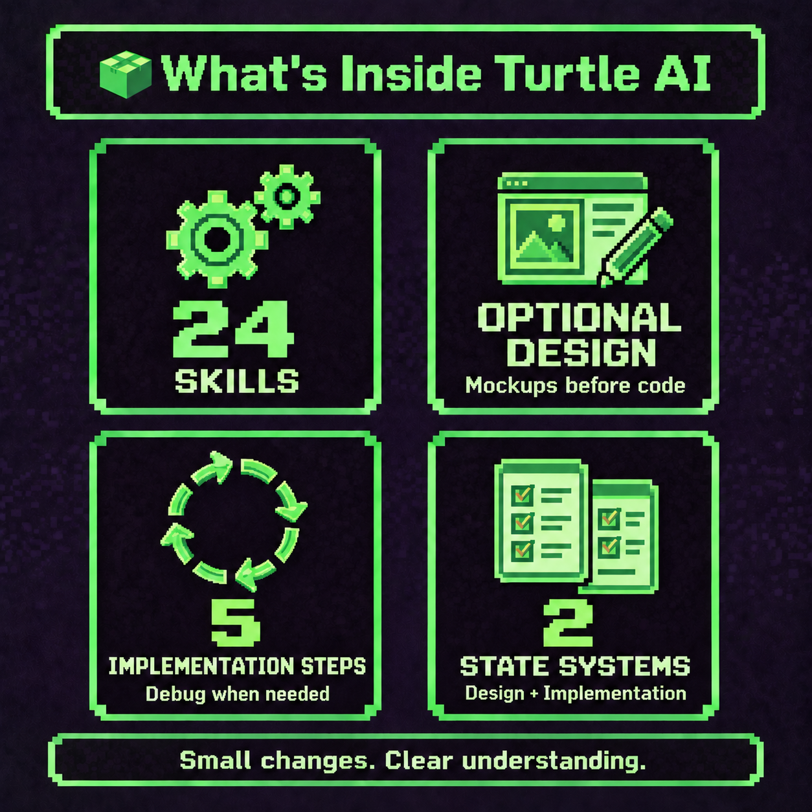

<p align="center">
  
</p>

[](https://wakatime.com/badge/github/heriberto-codes/turtle_ai)

# Turtle AI

**Version:** v1.1.0

> Build with AI without losing understanding.

Turtle AI is a collection of Codex **skills**—reusable instructions for specific tasks—and Markdown workflow rules that help you build software in small, reviewable steps. You add Turtle to your project's **repository** (the project folder and its Git history), then use its skills in Codex chat to plan, design, implement, and review changes.

You bring the project, development tools, and testing environment. Turtle provides the workflow: AI helps with the work, and you stay responsible for understanding the result.

## Why Understanding Is a Gate

It is easy to accept AI-generated code that works without knowing why it works. Turtle makes understanding a required **checkpoint**: a short conversation that checks whether you can explain the change before moving on.

For a contact form, that might mean explaining where validation happens, why an invalid email is rejected, and how the form connects to the rest of your app. If something is unclear, the checkpoint helps you work through it. You do not need to get every answer right on the first try.

The goal is to keep changes small enough to review, test, and understand so you can maintain your own project later.

## Before You Start

- Use a Codex environment that supports repository skills and `AGENTS.md` instructions.
- Have a project folder under Git version control. A new project can start with an empty repository; an existing project can keep its current files and tools.
- Have the tools needed to run and test your project, such as its language runtime or framework. Turtle itself has no package dependencies or application server to start.

Follow [installation](#install-turtle-in-your-project), [foundation setup](#set-up-your-project-foundation), and then [choose a workflow](#choose-your-workflow). The [skill catalog](#skill-catalog) is a reference once you know the path you need.

## Install Turtle in Your Project

Choose either option below; both add the same project-local Turtle files. Installation only copies the workflow material. Generating your project's foundation documents is a separate step afterward.

### Option A: Ask Codex to Install Turtle

Open **your destination project folder** in Codex—not the Turtle repository—and paste this into Codex chat:

```text
Add Turtle AI to the project currently open in Codex:
https://github.com/heriberto-codes/turtle_ai

Confirm the destination project path before writing files.
If the destination is ambiguous, ask me to identify it.

Download or clone the current main branch into a temporary
location outside my project. Use one source revision throughout
and report its commit ID.

Copy only:
- All 22 turtle-* skill directories, including their contents,
  into this project's .agents/skills/.
- workflow.md, design-workflow.md, state.md, and rules.md from
  Turtle's docs/system/ into this project's docs/system/.
- Turtle's LICENSE into docs/licenses/turtle-ai-LICENSE.txt.

Inspect destination files before copying. Preserve unrelated
skills, project documentation, and my project's existing license.
Leave identical files unchanged. If existing files differ, report
the conflicts and ask before replacing or merging anything.

Do not copy Turtle's AGENTS.md, architecture.md, or repo_map.md;
those describe Turtle itself, not my project.
Do not modify application code, run downloaded scripts, generate
foundation documents, install skills globally, commit, or push.

Verify the installed files and report changes, missing files,
and unresolved conflicts. Do not claim installation is complete
if required files are missing or conflicts remain.

Then explain how to start a fresh Codex session, check skill
availability, and begin the existing foundation setup.
```

This is **Codex-assisted copying**, not a built-in Turtle installer. Codex may ask you to approve network access or file permissions. If downloading is unavailable, use the manual option below. Review its installation report and resolve any conflicts before continuing to [Check Your Installation](#check-your-installation).

### Option B: Install Manually

1. Get a copy of this repository's current `main` branch. On [GitHub](https://github.com/heriberto-codes/turtle_ai), select **Code → Download ZIP** and extract it. Or run this in a terminal from a folder where you keep source repositories:

   ```bash
   git clone https://github.com/heriberto-codes/turtle_ai.git
   ```

2. Find `.agents/skills/` in the downloaded Turtle folder. Folders starting with a dot may be hidden: press **Command + Shift + .** in macOS Finder, or enable **View → Show → Hidden items** in Windows File Explorer.
3. In your own project folder, create `.agents/skills/` if needed. Copy all **22 `turtle-*` folders**, including their contents, into it. Keep any unrelated skills already there.
4. Create `docs/system/` in your project if needed. Copy these four files from Turtle's `docs/system/`: `workflow.md`, `design-workflow.md`, `state.md`, and `rules.md`. The design skills read these shared documents directly.
5. Preserve Turtle's license notice: create `docs/licenses/` and copy Turtle's root `LICENSE` into it as `turtle-ai-LICENSE.txt`. Keep your project's own license file as it is.
6. Open **your project folder** in Codex and continue to [Check Your Installation](#check-your-installation).

If a destination skill folder or system document already has the same name, compare it with the incoming copy before replacing anything. Preserve local customizations and resolve differences explicitly. For later Turtle updates, repeat this comparison using skills and system documents from the same source revision.

### Check Your Installation

After either installation option, start a fresh Codex chat in **your project** so it can discover the copied skills.

Your copied files should look like this; the other 20 skill folders are omitted from the picture:

```text
your-project/
|-- .agents/skills/
|   |-- turtle-agents/SKILL.md
|   |-- turtle-architecture/SKILL.md
|   `-- ...
`-- docs/
    |-- system/
    |   |-- workflow.md
    |   |-- design-workflow.md
    |   |-- state.md
    |   `-- rules.md
    `-- licenses/turtle-ai-LICENSE.txt
```

Paste this into Codex chat to check the installation without changing files:

```text
Check my Turtle AI installation without modifying files. Confirm that all
22 turtle-* skill folders have a readable SKILL.md with a matching name,
and report whether those skills are available in this Codex session.
Check for workflow.md, design-workflow.md, state.md, and rules.md under
docs/system/, plus docs/licenses/turtle-ai-LICENSE.txt. Report missing
files or name conflicts. Do not run the skills or generate foundation files yet.
```

Resolve any missing files or conflicts before following [Set Up Your Project Foundation](#set-up-your-project-foundation). Installation does not create or refresh your project's `AGENTS.md`, `architecture.md`, or `repo_map.md`.

### How to Invoke a Skill

Enter skill requests in **Codex chat**, one at a time. For example:

```text
$turtle-agents
```

These are chat requests, not terminal commands. Codex also documents `/skills` as a way to select a skill; see [OpenAI's invocation guidance](https://developers.openai.com/blog/eval-skills). You can add context after the skill name, including the feature you want to work on.

## Set Up Your Project Foundation

Run these skills in order, waiting for each to finish:

| Order | Enter in Codex chat | Creates or refreshes |
| --- | --- | --- |
| 1 | `$turtle-agents` | `AGENTS.md`: repository rules and safety constraints. |
| 2 | `$turtle-architecture` | `architecture.md`: the current system blueprint. |
| 3 | `$turtle-repo-map` | `repo_map.md`: a navigation guide to important files and boundaries. |

After creating or changing `AGENTS.md`, begin a fresh Codex chat in the project before continuing so the repository instructions are loaded. For a Turtle-managed project, ask `$turtle-agents` to include the plan-step order, comprehension gate, and state ownership rules from `docs/system/rules.md` in its concise guardrails.

The foundation skills preserve valid existing content and update it incrementally. `$turtle-agents` can run before the other two documents exist. It creates uppercase `AGENTS.md`; if only legacy lowercase `agents.md` exists, it migrates its valid content to the canonical filename. If both exist, it stops for you to reconcile them. Other Turtle skills use lowercase only as a temporary fallback when uppercase is absent.

The foundation documents in **this Turtle repository describe Turtle itself**. Generate your project's versions from its own files instead of copying Turtle's versions. In an empty project, record unknowns honestly; these skills do not choose or scaffold an application stack. Refresh the documents after initial scaffolding and whenever rules, architecture, or repository structure materially change.

## Choose Your Workflow

### Path A: Design Workflow

Use this path when a feature changes a page, screen, user journey, or interaction and you want to explore design choices before implementation.

[Design Workflow](docs/system/design-workflow.md).

### Path B: Engineering Workflow

Use this path for backend work, internal refactors, maintenance, or other work that needs no design exploration.

[Engineering Workflow](docs/guides/planning_workflow.md).

## What's Included



- **22 skills** for focused development tasks.
- **Optional design workflow** to explore mockups and approve a direction before coding.
- **5-step implementation loop:** execute → verify → engineer checkpoint (understand the change) → test → plan step update. Debugging is conditional recovery, not an extra required step.
- **2 state systems:** design workflow progress and implementation-plan progress.

## Skill Catalog

Turtle includes 22 project-local skills in `.agents/skills/`. Their names describe focused responsibilities; you do not need to memorize the full catalog to begin.

| Category | Skills |
| --- | --- |
| Foundation | `turtle-agents`, `turtle-architecture`, `turtle-repo-map` |
| Discovery | `turtle-ideate`, `turtle-backlog`, `turtle-analyze` |
| Design (optional) | `turtle-design-next`, `turtle-design-audit`, `turtle-design-mockup`, `turtle-design-checkpoint` |
| Planning | `turtle-plan` |
| Implementation | `turtle-execute`, `turtle-verify`, `turtle-engineer-checkpoint`, `turtle-test`, `turtle-debug`, `turtle-plan-step-update` |
| Hardening | `turtle-security`, `turtle-performance` |
| Finalization | `turtle-backlog-update`, `turtle-document`, `turtle-commit` |

## Foundation and Workflow Files

Turtle's foundation and workflow files have distinct responsibilities:

| Location | Role |
| --- | --- |
| Root `AGENTS.md` | Concise repository guardrails loaded as Codex instructions. |
| Root `architecture.md` | Current system blueprint, boundaries, and ownership. |
| Root `repo_map.md` | Navigation guide to important files and protected paths. |
| `.agents/skills/*/SKILL.md` | Detailed procedure for one skill, loaded when that skill applies. |
| `docs/system/` | Shared workflow and state rules used across skills. |

Skill procedures define each phase's operational behavior. Repository files remain authoritative if architecture or navigation documentation becomes stale. Keep the foundation current as your project evolves.

## Current Limitations

Turtle is an instruction-based workflow carried out by Codex, with human review and file-based state. It does not mechanically enforce every gate or guarantee bug-free or secure code. Some gate evidence lives in the conversation, so a new chat may need to re-establish it. This source repository currently has no automated contract-test suite or CI workflow, and mockup previews depend on the tools available in your environment. See [architectural risks](architecture.md#known-risks) for the current maintenance concerns.

## Documentation

The README is the starting guide. These documents explain the system and its detailed workflow rules:

- [Architecture](architecture.md)
- [Repository Map](repo_map.md)
- [Workflow Reference](docs/system/workflow.md)
- [Design Workflow](docs/system/design-workflow.md)
- [Engineering Workflow](docs/guides/planning_workflow.md)
- [State System](docs/system/state.md)
- [Global Rules](docs/system/rules.md)

## License

Turtle AI is licensed under the [MIT License](LICENSE). When copying or redistributing Turtle material, retain its copyright and license notice. The installation steps preserve a copy under `docs/licenses/` alongside your project's existing license.
