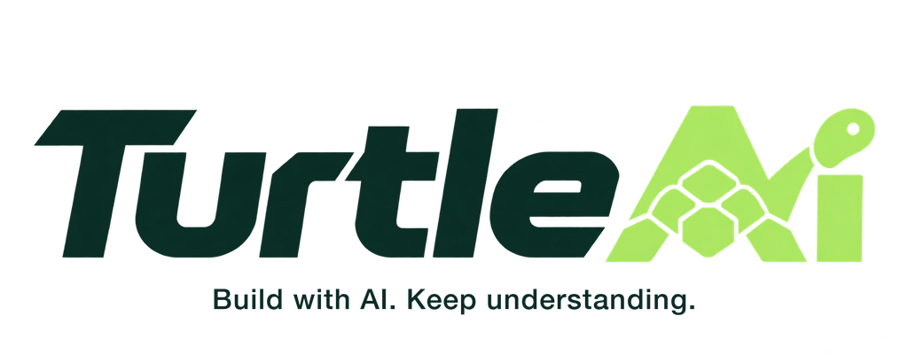
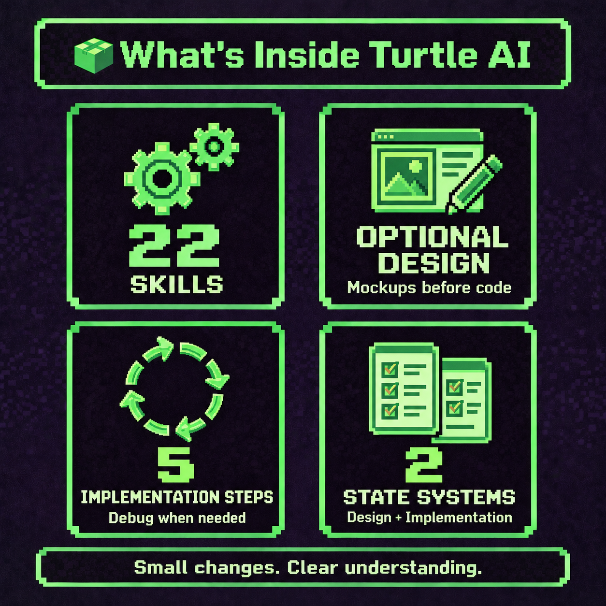

<p align="center">
  
</p>

[](https://wakatime.com/badge/user/3a78d911-a08a-40c2-bf2c-782c4d20eb23/project/083c1137-37af-417a-8f7d-632880b2dc31)

# Turtle AI

**Version:** v1.0.0

> Build with AI without losing understanding.

Turtle AI is an AI coding workflow where progress is gated by engineer comprehension, not just code generation. It is designed to preserve engineer understanding, codebase context, and long-term ownership while still using AI to move faster.

Most AI coding tools optimize for speed. Turtle AI optimizes for control.

## Why It Exists

The common failure mode of AI-assisted development is that the engineer gradually loses real understanding of their own codebase.

Turtle AI prevents that by keeping changes small, reviewable, and tied to a plan. The engineer remains the source of truth, while AI acts as a constrained implementation partner.

## Core Loop

Every implementation step moves through the same controlled loop:

```text
EXECUTE -> VERIFY -> ENGINEER CHECKPOINT -> TEST -> DEBUG -> PLAN STEP UPDATE
```

At the center of the loop is `ENGINEER CHECKPOINT`.

Before work can move forward, the engineer must be able to explain:

- what was implemented
- why it works
- how it fits into the system

That comprehension gate is the core distinction of Turtle AI.

## Quick Start

1. Open this repo in Codex.
2. Ensure `.agents/skills/` exists.
3. Run the foundation skills once:
   - `/turtle-agents`
   - `/turtle-architecture`
   - `/turtle-repo-map`
4. Optionally run discovery:
   - `/turtle-ideate`
   - `/turtle-backlog`
   - `/turtle-analyze`
5. For a user-facing feature with meaningful design decisions, optionally run `/turtle-design-next` repeatedly. It guides audit, section confirmation, mockups, selection, assembly, approval, backlog, and planning one safe transition at a time.
6. If the automated design phase was skipped, pick a feature from `docs/backlog.md`.
7. Create a plan when the design controller has not already created one:
   - `/turtle-plan`
8. Run the implementation loop until complete:
   - `/turtle-execute`
   - `/turtle-verify`
   - `/turtle-engineer-checkpoint`
   - `/turtle-test`
   - `/turtle-debug` if needed
   - `/turtle-plan-step-update`
9. Finalize the feature:
   - `/turtle-security`
   - `/turtle-performance`
   - `/turtle-backlog-update`
   - `/turtle-document`
   - `/turtle-commit`

The active step is always the first unchecked item in `docs/plans/<feature_slug>_plan.md`.

On a new project, `/turtle-agents` runs first and creates the canonical root `AGENTS.md`. It does not require `architecture.md` or `repo_map.md` to exist yet. After changing repository instructions, begin a new Codex session so the refreshed instruction chain is loaded.

## Optional Design Workflow

Use Turtle's design workflow when a feature materially changes a page, screen, user journey, visual system, or interaction pattern. Skip it for backend-only work, internal refactors, dependency maintenance, and other changes with no meaningful design decision.

Run `/turtle-design-next` repeatedly to move through one safe transition at a time:

```text
DESIGN AUDIT -> SECTION MOCKUPS -> PAGE ASSEMBLY -> DESIGN CHECKPOINT -> BACKLOG -> PLANNING
```

The controller pauses for the user's section confirmation, mockup selections, and final design approval. It stores the design artifacts in `docs/design/<feature_slug>/` and stops after planning; neither the controller nor its specialist design skills modify production code.

For manual control, run `/turtle-design-audit`, `/turtle-design-mockup`, and `/turtle-design-checkpoint` directly. See the [Design Workflow](docs/system/design-workflow.md) for artifact ownership, workflow state, and recovery rules.

## What's Included



Turtle AI includes repo-scoped Codex skills in `.agents/skills/`.

| Category | Skills |
| --- | --- |
| Foundation | `turtle-agents`, `turtle-architecture`, `turtle-repo-map` |
| Discovery | `turtle-ideate`, `turtle-backlog`, `turtle-analyze` |
| Design (optional) | `turtle-design-next`, `turtle-design-audit`, `turtle-design-mockup`, `turtle-design-checkpoint` |
| Planning | `turtle-plan` |
| Implementation | `turtle-execute`, `turtle-verify`, `turtle-engineer-checkpoint`, `turtle-test`, `turtle-debug`, `turtle-plan-step-update` |
| Hardening | `turtle-security`, `turtle-performance` |
| Finalization | `turtle-backlog-update`, `turtle-document`, `turtle-commit` |

## Codex Skills Support

Turtle AI runs as a repo-scoped Codex skill set located in:

```text
.agents/skills/
```

Once the repository is opened, Codex discovers these skills automatically. Commands such as `/turtle-plan`, `/turtle-execute`, and `/turtle-verify` become available from the Codex skill system.

Turtle AI requires `.agents/skills/`. If that directory is missing, Turtle commands will not be available.

## Repository Instructions

`AGENTS.md` and `.agents/skills/` have separate roles:

- Root `AGENTS.md` contains concise guardrails that apply throughout work in the repository.
- `.agents/skills/*/SKILL.md` contains the detailed procedure for a specific Turtle phase and is loaded when that skill applies.
- `docs/system/` explains the shared workflow and state model without duplicating every skill procedure.

`/turtle-agents` creates and maintains uppercase `AGENTS.md`. For compatibility, Turtle skills may read a legacy lowercase `agents.md` only when `AGENTS.md` is absent. `/turtle-agents` migrates a legacy-only file to the canonical name. If both files exist, it stops and requests reconciliation rather than merging them silently.

The `AGENTS.md` in this repository governs maintenance of Turtle AI itself. When `/turtle-agents` runs in another project, it generates project-specific rules from that repository instead of copying this file verbatim.

## Documentation

The README is the entry point. The detailed workflow reference lives in the system docs:

- [Workflow Reference](docs/system/workflow.md)
- [Design Workflow](docs/system/design-workflow.md)
- [State System](docs/system/state.md)
- [Global Rules](docs/system/rules.md)
